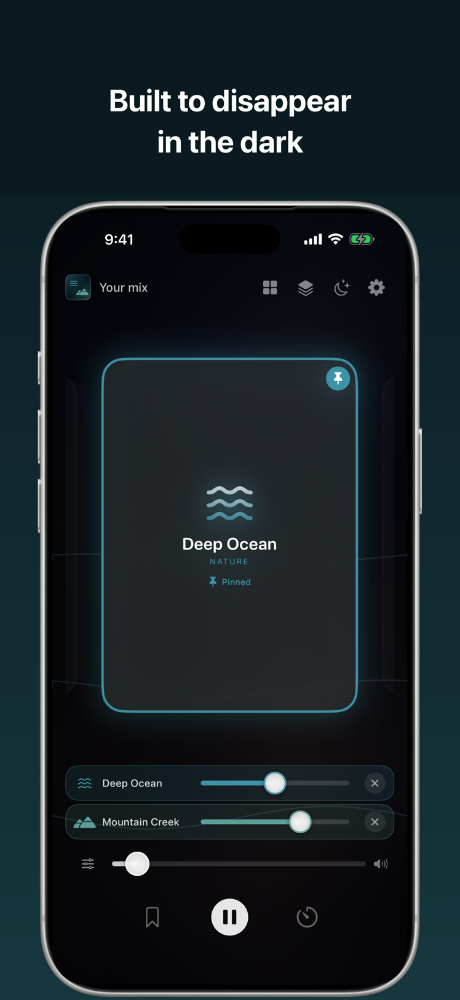

🇺🇸 [English](README.md) | 🇩🇪 [Deutsch](README_de.md) | 🇪🇸 [Español](README_es.md) | 🇫🇷 **Français** | 🇮🇹 [Italiano](README_it.md) | 🇯🇵 [日本語](README_ja.md) | 🇳🇱 [Nederlands](README_nl.md) | 🇧🇷 [Português](README_pt-BR.md) | 🇨🇳 [中文](README_zh-Hans.md)

# Dreamwave Radio - Sons pour dormir, bruit blanc et mixeur d'ambiance pour iPhone et iPad

**Mélangez des sons d'ambiance à votre façon et endormez-vous sur une minuterie. Aucun compte, aucun suivi, rien ne quitte votre appareil.**

**Un seul achat, à vous pour toujours.** Pas d'abonnement, pas de publicité, pas d'achats intégrés.

La plupart des applis de sommeil vous donnent une liste figée et une facture mensuelle. Dreamwave Radio vous donne une table de mixage. Posez la pluie sur un feu de cheminée, glissez un ventilateur sous un train de nuit et réglez chaque niveau séparément jusqu'à obtenir la pièce dans laquelle vous voulez vraiment vous endormir.

---

## 🆕 Nouveautés de la 2.0

- **Nouveau look :** chaque mix a maintenant sa propre pochette. Le mix en cours s'affiche en haut de l'écran, vos mix s'ouvrent en grille de pochettes et la pochette brille doucement derrière vos sons.
- **Paysages de rêve :** trois nouveaux sons pour le soir et pour la concentration : Horizon néon, Drone de minuit et Ronronnement de lampes. Et deux nouveaux mix prêts à l'emploi, Côte néon et Pluie de minuit.
- **Siri dans votre langue :** Siri vous comprend désormais dans votre langue. Dites par exemple « Mets Pluie sur la tente dans Dreamwave » ou « Donne-moi plus de temps dans Dreamwave ».
- **Une nouvelle icône,** et sur votre écran d'accueil l'app s'appelle désormais simplement Dreamwave.
- **Vos mix restent les vôtres :** vos mix enregistrés restent tels quels, et vous pouvez donner à chacun une de vos photos comme pochette. Les nouveaux mix s'ajoutent tant qu'il reste de la place.

---

## ✨ Ce qui la rend différente

### 🎚️ Mélangez jusqu'à trois sons à la fois

Pas une playlist - un mélange. Épinglez jusqu'à trois stations et réglez chaque niveau séparément. Pluie sur la tente au-dessus d'un orage lointain. Vent de nuit sous un feu de cheminée. La combinaison est tout l'intérêt.

### 💾 Des mix à portée de doigt

Commencez avec cinq mix tout prêts : Nuit de pluie, Concentration, Sommeil doux, Côte néon et Pluie de minuit. Ou gardez le vôtre : épinglez jusqu'à trois sons, réglez chaque niveau et touchez le signet à côté de Lecture. Chaque mix a sa propre pochette, et vous pouvez donner à n'importe quel mix enregistré une de vos photos. Vos mix s'ouvrent en grille de pochettes, et un toucher ramène n'importe lequel, niveaux compris.

### 📚 Pour la concentration et les études

Les mêmes sons servent aussi le jour. Un bruit brun sous la pluie sur une fenêtre couvre les conversations au bureau, au café ou en colocation, pour vous concentrer, étudier ou lire.

### 🔊 Le calme toute la nuit

Pas de craquement, pas de raccord audible. Vos sons continuent, réguliers, aussi longtemps que vous en avez besoin : une longue nuit reste un son calme et continu, pas une piste qui recommence sans cesse. Le Vent de nuit monte et retombe en rafales. Avec Pluie lointaine, chaque goutte tombe à un endroit nouveau. Le Ronronnement fait des pauses, comme un chat.

### 🗣️ Demandez, simplement

« Lance Dreamwave. » « Donne-moi plus de temps dans Dreamwave. » Siri et Raccourcis lancent votre son sans que vous ayez à regarder un écran lumineux. Siri vous comprend désormais dans votre langue, et tout ce que fait Siri existe aussi en raccourci, un son peut donc faire partie de votre rituel du soir.

### ⏱️ Une minuterie qui s'estompe

Des préréglages pour les nuits habituelles, ou faites glisser l'échelle sur n'importe quelle durée de 1 à 120 minutes. Le mélange s'estompe au lieu de s'arrêter net, la minuterie ne vous réveille donc jamais en partant. Pendant qu'elle tourne, elle s'affiche sur l'écran verrouillé et dans la Dynamic Island, un coup d'œil suffit pour voir le temps restant.

### 🌙 Mode nuit

Atténue toute l'interface pour une chambre sombre, consulter la minuterie ne veut donc pas dire se prendre une lampe torche en pleine figure.

### 📱 À l'aise sur iPhone et iPad

Une seule appli, conçue pour les deux. Sur iPhone, elle reste accessible d'une main dans le noir. Sur iPad, la bibliothèque de sons s'ouvre en plein écran, toute la bibliothèque devant vous d'un coup.

### 🎧 Joue sous vos podcasts

Activez « Jouer avec d'autres sons » dans les réglages : votre mélange joue doucement sous un podcast ou un livre audio au lieu de l'arrêter. Désactivé par défaut.

### 🔒 Aucun compte, aucun réseau, aucune donnée

Aucune inscription, aucune analyse, aucun serveur, et l'appli ne demande jamais votre micro. Une photo choisie comme pochette d'un mix reste sur votre appareil. L'appli ne collecte pas de données parce qu'elle n'a nulle part où les envoyer. Voir la [Politique de confidentialité](privacy_policy.md).

---

## 📸 Captures d'écran

| | | |
|:--:|:--:|:--:|
|  |  |  |
|  |  |  |

---

## 🎵 La bibliothèque de sons

34 sons en six catégories, du bruit pur au train qui passe dans la nuit.

**Bruit** - Bruit blanc · Bruit rose · Silence profond (bruit brun) · Bruit gris · Bruit vert · Bruit bleu · Bruit violet
**Apaisant** - Ventre maternel · Ventilateur · En voiture · Dérive lente · Ronronnement · Cabine d'avion · Chut
**Météo** - Pluie sur la tente · Pluie sur la vitre · Orage lointain · Vent de nuit · Pluie lointaine · Vent des prairies
**Nature** - Océan profond · Nuit en forêt · Rue d'été · Ruisseau de montagne · Chant d'oiseaux · Grillons
**Cocooning** - Cheminée · Train de nuit · Crépitement vinyle · Douche · Bateau bercé
**Paysages de rêve** - Horizon néon · Drone de minuit · Ronronnement de lampes

---

## ❓ Questions fréquentes

**Pourquoi l'app s'appelle-t-elle Dreamwave sur mon écran d'accueil ?**

Depuis la 2.0, le nom sous l'icône est simplement Dreamwave. L'app s'appelle toujours Dreamwave Radio, dans l'App Store comme dans l'app, et Siri comprend les deux noms.

**Mes mix enregistrés restent-ils après la mise à jour ?**

Oui. Vos mix enregistrés restent exactement tels quels. Les deux nouveaux mix prêts à l'emploi, Côte néon et Pluie de minuit, s'ajoutent tant qu'il reste de la place, et vous pouvez donner à chaque mix une de vos photos comme pochette.

**La 2.0 est-elle payante si j'ai déjà l'app ?**

Non. La 2.0 est une mise à jour gratuite pour tous ceux qui ont déjà Dreamwave Radio. Un seul achat, pour toujours : tous les sons, y compris ceux à venir, sont inclus.

**L'app a-t-elle besoin d'accéder à mes photos ?**

Non. Quand vous choisissez une photo comme pochette d'un mix, le sélecteur de photos du système ne transmet à l'app que cette photo, jamais votre photothèque. Elle reste sur votre appareil et n'est jamais envoyée nulle part.

**Fonctionne-t-elle hors ligne ?**

Oui, entièrement. Chaque son est joué directement sur votre appareil, en mode avion comme dans le train ou dans un hôtel sans Wi-Fi.

**Peut-elle aider en cas d'acouphènes ?**

Beaucoup de gens utilisent un bruit doux pour que le sifflement dans les oreilles se remarque moins, et Dreamwave Radio propose sept couleurs de bruit pour trouver celle qui vous convient. Ce n'est pas un dispositif médical et elle ne soigne pas les acouphènes. Si vos oreilles sifflent souvent ou si c'est nouveau, consultez un médecin.

---

## 📱 Configuration

- iOS 17.0 ou version ultérieure
- iPhone et iPad

---

## 🌍 Langues

Anglais, allemand, espagnol, français, italien, japonais, néerlandais, portugais du Brésil et chinois simplifié. Les noms des sons sont traduits aussi.

---

## 💬 Retours

Ce dépôt est l'endroit du support. Il ne contient aucun code source : il existe pour les tickets, la documentation et la politique de confidentialité.

- [Signaler un bug](https://github.com/aloth/dreamwave-radio/issues/new?template=bug-report.md) - plantages, sons qui ne se lisent pas, tout ce qui ne fonctionne pas comme documenté
- [Proposer une fonction](https://github.com/aloth/dreamwave-radio/issues/new?template=feature_request.md) - un son que vous voulez, un réglage qui vous manque
- [Parcourir les tickets existants](https://github.com/aloth/dreamwave-radio/issues) - quelqu'un l'a peut-être déjà signalé
- [support@alexloth.com](mailto:support@alexloth.com?subject=Dreamwave%20Radio) - pour tout ce que vous préférez ne pas publier

---

## 📄 Mentions légales

- [Politique de confidentialité](privacy_policy.md)
- [Conditions d'utilisation (CLUF standard Apple)](https://www.apple.com/legal/internet-services/itunes/dev/stdeula/)

---

Réalisé par [Alexander Loth](https://github.com/aloth) · [alexloth.com](https://alexloth.com) · [X](https://x.com/xlth)

*Pour des nuits plus calmes.* © 2026 Alexander Loth
