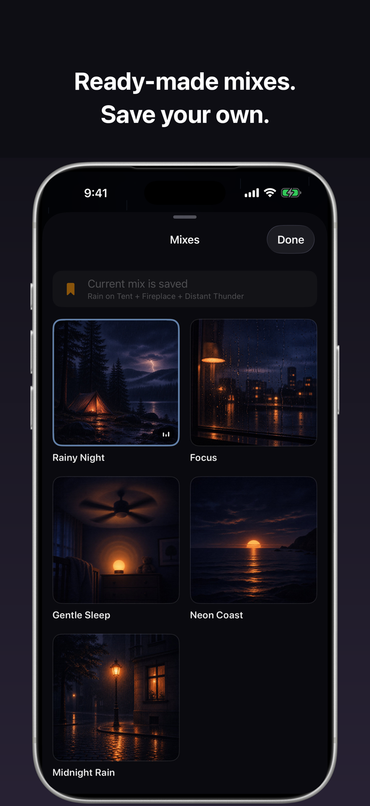

🇺🇸 [English](README.md) | 🇩🇪 [Deutsch](README_de.md) | 🇪🇸 [Español](README_es.md) | 🇫🇷 [Français](README_fr.md) | 🇮🇹 **Italiano** | 🇯🇵 [日本語](README_ja.md) | 🇳🇱 [Nederlands](README_nl.md) | 🇧🇷 [Português](README_pt-BR.md) | 🇨🇳 [中文](README_zh-Hans.md)

# Dreamwave Radio - Suoni per dormire, rumore bianco e mixer ambientale per iPhone e iPad

**Mescola suoni ambientali a modo tuo e addormentati con un timer. Nessun account, nessun tracciamento, niente lascia il tuo dispositivo.**

**Acquisti una volta, tua per sempre.** Nessun abbonamento, nessuna pubblicità, nessun acquisto in-app.

La maggior parte delle app per dormire ti da una scaletta fissa e una fattura mensile. Dreamwave Radio ti da un banco di missaggio. Metti la pioggia sopra un camino, infila un ventilatore sotto un treno notturno e regola il livello di ognuno separatamente finché non suona come la stanza in cui vuoi davvero addormentarti.

---

## 🆕 Novità della 2.0

- **Nuovo aspetto:** ogni mix ha ora la sua copertina. Il mix in riproduzione è in alto sullo schermo, i tuoi mix si aprono come una griglia di copertine e la copertina brilla delicatamente dietro i tuoi suoni.
- **Paesaggi onirici:** tre nuovi suoni per la sera e per la concentrazione: Orizzonte al neon, Drone di mezzanotte e Ronzio valvolare. In più due nuovi mix pronti, Costa al neon e Pioggia di mezzanotte.
- **Siri nella tua lingua:** ora Siri ti capisce nella tua lingua. Prova a dire «Metti Pioggia sulla tenda su Dreamwave» o «Dammi più tempo su Dreamwave».
- **Una nuova icona,** e nella schermata Home l'app ora si chiama semplicemente Dreamwave.
- **I tuoi mix restano tuoi:** i tuoi mix salvati restano come sono, e puoi dare a ognuno una tua foto come copertina. I nuovi mix si aggiungono finché c'è spazio.

---

## ✨ Cosa la rende diversa

### 🎚️ Mixa fino a tre suoni insieme

Non una playlist - un mix. Fissa fino a tre stazioni e regola ogni livello separatamente. Pioggia sulla tenda sopra un tuono lontano. Vento notturno sotto un camino. La combinazione è il punto.

### 💾 Mix a portata di tocco

Parti da cinque mix già pronti: Notte di pioggia, Concentrazione, Sonno dolce, Costa al neon e Pioggia di mezzanotte. Oppure salva il tuo: fissa fino a tre suoni, regola ogni livello e tocca il segnalibro accanto a Riproduci. Ogni mix ha la sua copertina, e a ogni mix salvato puoi dare una tua foto. I tuoi mix si aprono come una griglia di copertine, e un tocco li richiama, livelli compresi.

### 📚 Per concentrarsi e studiare

Gli stessi suoni funzionano anche di giorno. Il rumore marrone sotto la pioggia sulla finestra copre le chiacchiere in ufficio, al bar o in una casa condivisa, così puoi concentrarti, studiare o leggere.

### 🔊 Quiete per tutta la notte

Nessun clic, nessuno stacco udibile. I tuoi suoni continuano uniformi per tutto il tempo che ti servono, così una lunga notte resta un suono calmo e continuo, non una traccia che ricomincia da capo. Il Vento notturno sale e scende a raffiche. Con Pioggia lontana ogni goccia cade in un punto nuovo. Le Fusa fanno pause, come farebbe un gatto.

### 🗣️ Basta chiedere

«Avvia Dreamwave.» «Dammi più tempo su Dreamwave.» Siri e Comandi Rapidi avviano il tuo suono senza che tu debba guardare uno schermo luminoso. Ora Siri ti capisce nella tua lingua, e tutto quello che fa Siri è anche un comando rapido, così un suono può far parte della tua routine serale.

### ⏱️ Un timer che sfuma

Preimpostazioni per le notti di sempre, oppure trascina la scala su qualsiasi durata da 1 a 120 minuti. Il mix sfuma invece di interrompersi di colpo, così il timer non ti sveglia mai andandosene. Mentre scorre resta sulla schermata di blocco e nella Dynamic Island, un'occhiata ti dice quanto manca.

### 🌙 Modalità notte

Attenua tutta l'interfaccia per una camera al buio, così controllare il timer non significa puntarti una torcia in faccia.

### 📱 A casa su iPhone e iPad

Un'app sola, fatta per entrambi. Su iPhone resta raggiungibile con una mano al buio. Su iPad la libreria dei suoni si apre a schermo intero, con tutta la libreria davanti a te in una volta.

### 🎧 Suona insieme ai podcast

Attiva «Riproduci insieme ad altro audio» nelle impostazioni e il tuo mix suonerà piano sotto un podcast o un audiolibro invece di fermarlo. Disattivato di default.

### 🔒 Nessun account, nessuna rete, nessun dato

Nessuna iscrizione, nessuna analisi, nessun server, e l'app non chiede mai il microfono. La foto che scegli come copertina di un mix resta sul tuo dispositivo. L'app non raccoglie dati perché non ha dove mandarli. Vedi l'[Informativa sulla privacy](privacy_policy.md).

---

## 📸 Schermate

| | | |
|:--:|:--:|:--:|
|  |  |  |
|  |  |  |

---

## 🎵 La libreria dei suoni

34 suoni in sei categorie, dal rumore puro a un treno che passa nel buio.

**Rumore** - Rumore bianco · Rumore rosa · Quiete profonda (rumore marrone) · Rumore grigio · Rumore verde · Rumore blu · Rumore viola
**Rilassante** - Grembo materno · Ventilatore · In auto · Deriva lenta · Fusa · Cabina d'aereo · Shhh
**Meteo** - Pioggia sulla tenda · Pioggia sul vetro · Tuono lontano · Vento notturno · Pioggia lontana · Vento della prateria
**Natura** - Oceano profondo · Notte nel bosco · Strada d'estate · Ruscello di montagna · Canto degli uccelli · Grilli
**Accogliente** - Camino · Treno notturno · Fruscio del vinile · Doccia · Barca cullata
**Paesaggi onirici** - Orizzonte al neon · Drone di mezzanotte · Ronzio valvolare

---

## ❓ Domande frequenti

**Perché sulla schermata Home l'app si chiama Dreamwave?**

Dalla 2.0 sotto l'icona c'è semplicemente Dreamwave. L'app si chiama sempre Dreamwave Radio, nell'App Store e dentro l'app, e Siri capisce entrambi i nomi.

**I miei mix salvati restano dopo l'aggiornamento?**

Sì. I tuoi mix salvati restano esattamente come sono. I due nuovi mix pronti, Costa al neon e Pioggia di mezzanotte, si aggiungono finché c'è spazio, e puoi dare a ogni mix una tua foto come copertina.

**La 2.0 costa qualcosa se ho già l'app?**

No. La 2.0 è un aggiornamento gratuito per chi ha già Dreamwave Radio. Acquisti una volta, tua per sempre: tutti i suoni, anche quelli futuri, sono inclusi.

**L'app ha bisogno di accedere alle mie foto?**

No. Quando scegli una foto come copertina di un mix, il selettore di foto del sistema passa all'app solo quella foto, mai la tua libreria. Resta sul tuo dispositivo e non viene mai caricata.

**Funziona offline?**

Sì, del tutto. Ogni suono viene riprodotto direttamente sul tuo dispositivo, quindi funziona in modalità aereo, in treno o in un hotel senza Wi-Fi.

**Può aiutare con l'acufene?**

Molte persone usano un fruscio delicato per sentire meno il fischio nelle orecchie, e Dreamwave Radio ha sette colori di rumore per trovare quello adatto a te. Non è un dispositivo medico e non cura l'acufene. Se le orecchie ti fischiano spesso o il fischio è nuovo, rivolgiti a un medico.

---

## 📱 Requisiti

- iOS 17.0 o successivo
- iPhone e iPad

---

## 🌍 Lingue

Inglese, tedesco, spagnolo, francese, italiano, giapponese, olandese, portoghese del Brasile e cinese semplificato. Anche i nomi dei suoni sono tradotti.

---

## 💬 Riscontri

Questo repository è il punto di supporto. Non contiene codice sorgente: esiste per le segnalazioni, la documentazione e l'informativa sulla privacy.

- [Segnala un bug](https://github.com/aloth/dreamwave-radio/issues/new?template=bug-report.md) - crash, suoni che non partono, tutto ciò che non funziona come documentato
- [Proponi una funzione](https://github.com/aloth/dreamwave-radio/issues/new?template=feature_request.md) - un suono che vuoi, un'impostazione che ti manca
- [Sfoglia le segnalazioni esistenti](https://github.com/aloth/dreamwave-radio/issues) - forse qualcuno l'ha già segnalato
- [support@alexloth.com](mailto:support@alexloth.com?subject=Dreamwave%20Radio) - per tutto ciò che preferisci non pubblicare

---

## 📄 Note legali

- [Informativa sulla privacy](privacy_policy.md)
- [Condizioni d'uso (EULA standard Apple)](https://www.apple.com/legal/internet-services/itunes/dev/stdeula/)

---

Realizzato da [Alexander Loth](https://github.com/aloth) · [alexloth.com](https://alexloth.com) · [X](https://x.com/xlth)

*Per notti più tranquille.* © 2026 Alexander Loth
