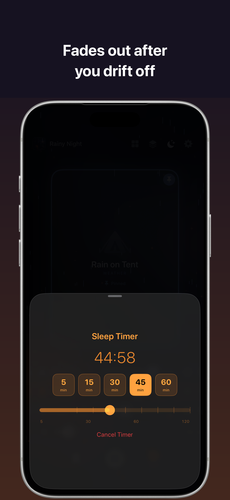

🇺🇸 [English](README.md) | 🇩🇪 [Deutsch](README_de.md) | 🇪🇸 [Español](README_es.md) | 🇫🇷 [Français](README_fr.md) | 🇮🇹 [Italiano](README_it.md) | 🇯🇵 [日本語](README_ja.md) | 🇳🇱 **Nederlands** | 🇧🇷 [Português](README_pt-BR.md) | 🇨🇳 [中文](README_zh-Hans.md)

# Dreamwave Radio - Slaapgeluiden, witte ruis en ambient-mixer voor iPhone en iPad

**Meng omgevingsgeluiden tot je eigen mix en val in slaap op een timer. Geen account, geen tracking, niets verlaat je apparaat.**

**Eén keer kopen, voor altijd van jou.** Geen abonnement, geen advertenties, geen in-app-aankopen.

De meeste slaapapps geven je een vaste afspeellijst en een maandelijkse rekening. Dreamwave Radio geeft je een mengpaneel. Leg regen over een haardvuur, zet een ventilator onder een nachttrein en regel elk niveau apart tot het klinkt als de kamer waarin je echt in slaap wilt vallen.

---

## 🆕 Nieuw in 2.0

- **Nieuwe look:** elke mix heeft nu een eigen cover. De mix die speelt staat bovenaan het scherm, je mixen openen als een raster van covers en de cover gloeit zacht achter je geluiden.
- **Droomlandschappen:** drie nieuwe geluiden voor de avond en om je te concentreren: Neonhorizon, Middernachtdrone en Buizengebrom. Plus twee nieuwe kant-en-klare mixen, Neonkust en Middernachtregen.
- **Siri in je eigen taal:** Siri begrijpt je nu in je eigen taal. Zeg bijvoorbeeld “Speel Regen op de tent in Dreamwave” of “Geef me meer tijd in Dreamwave”.
- **Een nieuw icoon,** en op je beginscherm heet de app nu gewoon Dreamwave.
- **Je mixen blijven van jou:** je bewaarde mixen blijven zoals ze zijn, en je kunt elke mix een eigen foto als cover geven. De nieuwe mixen komen erbij zolang er plaats is.

---

## ✨ Wat het anders maakt

### 🎚️ Meng tot drie geluiden tegelijk

Geen afspeellijst - een mix. Zet tot drie stations vast en regel elk niveau apart. Regen op de tent boven verre donder. Nachtwind onder een haardvuur. De combinatie is waar het om gaat.

### 💾 Mixen met één tik

Begin met vijf kant-en-klare mixen: Regennacht, Focus, Zacht inslapen, Neonkust en Middernachtregen. Of bewaar je eigen mix: zet tot drie geluiden vast, regel elk niveau en tik op de bladwijzer naast Afspelen. Elke mix heeft een eigen cover, en elke bewaarde mix kun je een eigen foto geven. Je mixen openen als een raster van covers, en met één tik haal je ze terug, niveaus inbegrepen.

### 📚 Voor focus en studeren

Dezelfde geluiden werken ook overdag. Bruine ruis onder regen op het raam dekt gepraat af op kantoor, in een café of in huis, zodat je je kunt concentreren, studeren of lezen.

### 🔊 De hele nacht rustig

Geen tikjes, geen hoorbare overgang. Je geluiden lopen gelijkmatig door zolang je ze nodig hebt, zodat een lange nacht één rustig, doorlopend geluid blijft in plaats van een track die steeds opnieuw begint. Nachtwind zwelt aan en neemt af in vlagen. Bij Verre regen valt elke druppel ergens anders. Spinnende kat pauzeert zoals een kat dat doet.

### 🗣️ Vraag het gewoon

“Speel regen in Dreamwave.” “Geef me meer tijd in Dreamwave.” Siri en Opdrachten starten je geluid, zonder dat je naar een fel scherm hoeft te kijken. Siri begrijpt je nu in je eigen taal, en alles wat Siri kan is ook een opdracht, zodat een geluid deel kan worden van je avondroutine.

### ⏱️ Een timer die wegvaagt

Voorinstellingen voor de gewone nachten, of sleep de schaal naar elke duur van 1 tot 120 minuten. De mix vervaagt in plaats van abrupt te stoppen, dus de timer maakt je nooit wakker bij zijn vertrek. Zolang hij aan staat, staat hij op het toegangsscherm en in de Dynamic Island, één blik en je weet hoeveel er nog rest.

### 🌙 Nachtmodus

Dimt de hele interface voor een donkere slaapkamer, zodat de timer checken niet betekent dat je een zaklamp in je gezicht schijnt.

### 📱 Thuis op iPhone en iPad

Eén app, voor allebei gebouwd. Op de iPhone blijft alles in het donker met één hand bereikbaar. Op de iPad opent de geluidsbibliotheek schermvullend, met de hele bibliotheek in één keer voor je.

### 🎧 Speelt mee met podcasts

Zet "Samen met andere audio afspelen" aan in de instellingen, dan speelt je mix zacht onder een podcast of luisterboek in plaats van die te stoppen. Standaard uit.

### 🔒 Geen account, geen netwerk, geen data

Geen aanmelding, geen analyse, geen server, en de app vraagt nooit om je microfoon. Een foto die je als cover van een mix kiest, blijft op je apparaat. De app verzamelt geen data omdat hij nergens heen kan sturen. Zie het [Privacybeleid](privacy_policy.md).

---

## 📸 Schermafbeeldingen

| | | |
|:--:|:--:|:--:|
|  |  |  |
|  |  |  |

---

## 🎵 De geluidsbibliotheek

34 geluiden in zes categorieën, van pure ruis tot een trein die door het donker rijdt.

**Ruis** - Witte ruis · Roze ruis · Diepe stilte (bruine ruis) · Grijze ruis · Groene ruis · Blauwe ruis · Violette ruis
**Rustgevend** - Moederschoot · Ventilator · Autorit · Trage stroming · Spinnende kat · Vliegtuigcabine · Sussen
**Weer** - Regen op de tent · Regen op het raam · Verre donder · Nachtwind · Verre regen · Prairiewind
**Natuur** - Diepe oceaan · Bosnacht · Zomerstraat · Bergbeek · Vogelzang · Krekels
**Behaaglijk** - Haardvuur · Nachttrein · Vinylgeknetter · Douche · Deinende boot
**Droomlandschappen** - Neonhorizon · Middernachtdrone · Buizengebrom

---

## ❓ Veelgestelde vragen

**Waarom heet de app Dreamwave op mijn beginscherm?**

Sinds 2.0 staat onder het icoon gewoon Dreamwave. De app zelf heet nog steeds Dreamwave Radio, in de App Store en in de app, en Siri begrijpt beide namen.

**Blijven mijn bewaarde mixen na de update bewaard?**

Ja. Je bewaarde mixen blijven precies zoals ze zijn. De twee nieuwe kant-en-klare mixen, Neonkust en Middernachtregen, komen erbij zolang er plaats is, en je kunt elke mix een eigen foto als cover geven.

**Kost 2.0 iets als ik de app al heb?**

Nee. 2.0 is een gratis update voor iedereen die Dreamwave Radio al heeft. Eén keer kopen, voor altijd van jou: alle geluiden en alle toekomstige geluiden zitten erbij.

**Heeft de app toegang tot mijn foto's nodig?**

Nee. Als je een foto als cover van een mix kiest, geeft de fotokiezer van het systeem de app alleen die ene foto, nooit je fotobibliotheek. De foto blijft op je apparaat en wordt nooit geüpload.

**Werkt de app offline?**

Ja, helemaal. Elk geluid speelt rechtstreeks op je apparaat, dus het werkt in vliegtuigmodus, in de trein of in een hotel zonder wifi.

**Kan de app helpen bij tinnitus?**

Veel mensen gebruiken zachte ruis om oorsuizen minder op te laten vallen, en Dreamwave Radio heeft zeven ruiskleuren, zodat je de kleur vindt die bij je past. De app is geen medisch hulpmiddel en behandelt geen tinnitus. Suizen je oren vaak of is het nieuw, ga dan naar een arts.

---

## 📱 Vereisten

- iOS 17.0 of nieuwer
- iPhone en iPad

---

## 🌍 Talen

Engels, Duits, Spaans, Frans, Italiaans, Japans, Nederlands, Braziliaans Portugees en vereenvoudigd Chinees. Ook de namen van de geluiden zijn vertaald.

---

## 💬 Feedback

Deze repository is waar de ondersteuning gebeurt. Er staat geen broncode in: hij bestaat voor meldingen, documentatie en het privacybeleid.

- [Een bug melden](https://github.com/aloth/dreamwave-radio/issues/new?template=bug-report.md) - crashes, geluiden die niet spelen, alles wat niet werkt zoals beschreven
- [Een functie voorstellen](https://github.com/aloth/dreamwave-radio/issues/new?template=feature_request.md) - een geluid dat je wilt, een instelling die je mist
- [Bestaande meldingen bekijken](https://github.com/aloth/dreamwave-radio/issues) - misschien heeft iemand het al gemeld
- [support@alexloth.com](mailto:support@alexloth.com?subject=Dreamwave%20Radio) - voor alles wat je liever niet openbaar zet

---

## 📄 Juridisch

- [Privacybeleid](privacy_policy.md)
- [Gebruiksvoorwaarden (Apple-standaard-EULA)](https://www.apple.com/legal/internet-services/itunes/dev/stdeula/)

---

Gemaakt door [Alexander Loth](https://github.com/aloth) · [alexloth.com](https://alexloth.com) · [X](https://x.com/xlth)

*Voor rustigere nachten.* © 2026 Alexander Loth
