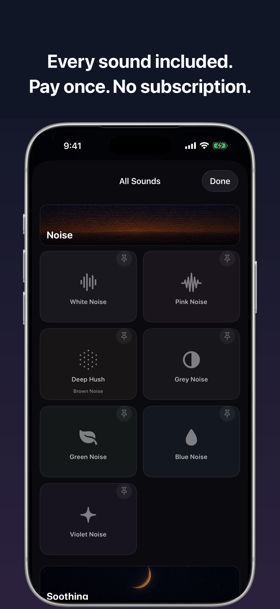
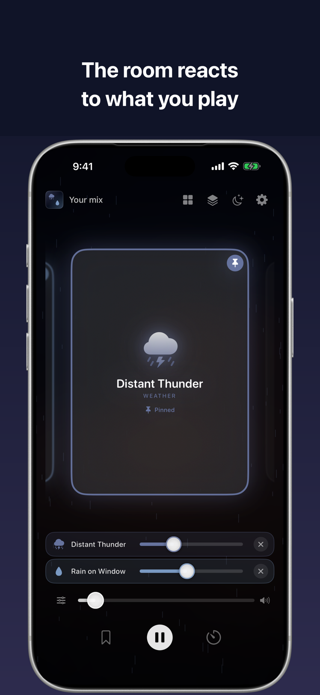

🇺🇸 [English](README.md) | 🇩🇪 [Deutsch](README_de.md) | 🇪🇸 [Español](README_es.md) | 🇫🇷 [Français](README_fr.md) | 🇮🇹 [Italiano](README_it.md) | 🇯🇵 [日本語](README_ja.md) | 🇳🇱 [Nederlands](README_nl.md) | 🇧🇷 **Português** | 🇨🇳 [中文](README_zh-Hans.md)

# Dreamwave Radio - Sons para dormir, ruído branco e mixer ambiente para iPhone e iPad

**Misture sons ambientes do seu jeito e durma com um timer. Sem conta, sem rastreamento, nada sai do seu aparelho.**

**Compre uma vez, é seu para sempre.** Sem assinatura, sem anúncios, sem compras no app.

A maioria dos apps de sono te dá uma playlist fixa e uma conta mensal. O Dreamwave Radio te dá uma mesa de mixagem. Ponha chuva sobre uma lareira, coloque um ventilador embaixo de um trem noturno e ajuste o nível de cada um separadamente até soar como o quarto em que você realmente quer dormir.

---

## 🆕 Novidades da 2.0

- **Visual novo:** cada mix agora tem sua própria capa. O mix que está tocando fica no topo da tela, seus mixes abrem como uma grade de capas e a capa brilha suavemente atrás dos seus sons.
- **Paisagens oníricas:** três sons novos para a noite e para se concentrar: Horizonte neon, Drone da meia-noite e Zumbido de válvula. E dois novos mixes prontos, Costa neon e Chuva da meia-noite.
- **Siri no seu idioma:** a Siri agora entende você no seu idioma. Diga, por exemplo, “Toque Chuva na barraca no Dreamwave” ou “Me dá mais tempo no Dreamwave”.
- **Um ícone novo,** e na tela de início o app agora se chama simplesmente Dreamwave.
- **Seus mixes continuam seus:** seus mixes salvos continuam como estão, e você pode dar a cada um uma foto sua como capa. Os novos mixes entram enquanto houver espaço.

---

## ✨ O que o torna diferente

### 🎚️ Misture até três sons ao mesmo tempo

Não é uma playlist - é uma mistura. Fixe até três estações e ajuste cada nível separadamente. Chuva na barraca sobre um trovão distante. Vento noturno embaixo de uma lareira. A combinação é o que importa.

### 💾 Mixes a um toque

Comece com cinco mixes prontos: Noite de chuva, Foco, Sono suave, Costa neon e Chuva da meia-noite. Ou salve o seu: fixe até três sons, ajuste cada nível e toque no marcador ao lado de Reproduzir. Cada mix tem sua própria capa, e você pode dar a qualquer mix salvo uma foto sua. Seus mixes abrem como uma grade de capas, e um toque traz qualquer um de volta, com os níveis.

### 📚 Para foco e estudo

Os mesmos sons funcionam de dia. Ruído marrom sob chuva na janela abafa as conversas no escritório, no café ou em casa, para você se concentrar, estudar ou ler.

### 🔊 Calma a noite toda

Sem estalos, sem emendas audíveis. Seus sons continuam tocando de forma uniforme pelo tempo que você precisar, então uma noite longa é um som calmo e contínuo, não uma faixa que fica recomeçando. O Vento noturno sobe e desce em rajadas. Em Chuva distante, cada gota cai num lugar novo. O Ronronar faz pausas, como um gato faria.

### 🗣️ É só pedir

“Toque chuva no Dreamwave.” “Me dá mais tempo no Dreamwave.” A Siri e os Atalhos começam seu som sem você precisar olhar para uma tela clara. A Siri agora entende você no seu idioma, e tudo o que a Siri faz também é um atalho, então um som pode fazer parte da sua rotina de dormir.

### ⏱️ Um timer que vai sumindo

Opções rápidas para as noites de sempre, ou arraste a escala para qualquer duração de 1 a 120 minutos. A mistura vai sumindo em vez de parar de uma vez, então o timer nunca te acorda ao ir embora. Enquanto roda, ele fica na tela bloqueada e na Dynamic Island, um relance basta para ver quanto falta.

### 🌙 Modo noturno

Escurece toda a interface para um quarto no escuro, então olhar o timer não é apontar uma lanterna para o próprio rosto.

### 📱 Em casa no iPhone e no iPad

Um app, feito para os dois. No iPhone continua ao alcance de uma mão no escuro. No iPad a biblioteca de sons abre em tela cheia, com a biblioteca inteira à sua frente de uma vez.

### 🎧 Toca junto com podcasts

Ative "Tocar junto com outro áudio" nos ajustes e o seu mix toca baixinho sob um podcast ou audiolivro em vez de pará-lo. Desativado por padrão.

### 🔒 Sem conta, sem rede, sem dados

Sem cadastro, sem análise, sem servidor, e o app nunca pede o seu microfone. A foto que você escolhe como capa de um mix fica no seu dispositivo. O app não coleta dados porque não tem para onde enviar. Veja a [Política de Privacidade](privacy_policy.md).

---

## 📸 Capturas de tela

| | | |
|:--:|:--:|:--:|
|  |  |  |
|  |  |  |

---

## 🎵 A biblioteca de sons

34 sons em seis categorias, do ruído puro a um trem passando no escuro.

**Ruído** - Ruído branco · Ruído rosa · Silêncio profundo (ruído marrom) · Ruído cinza · Ruído verde · Ruído azul · Ruído violeta
**Relaxante** - Ventre materno · Ventilador · Viagem de carro · Deriva lenta · Ronronar · Cabine de avião · Shhh
**Clima** - Chuva na barraca · Chuva na janela · Trovão distante · Vento noturno · Chuva distante · Vento da pradaria
**Natureza** - Oceano profundo · Noite na floresta · Rua de verão · Riacho da montanha · Canto dos pássaros · Grilos
**Aconchegante** - Lareira · Trem noturno · Chiado de vinil · Chuveiro · Barco balançando
**Paisagens oníricas** - Horizonte neon · Drone da meia-noite · Zumbido de válvula

---

## ❓ Perguntas frequentes

**Por que o app se chama Dreamwave na minha tela de início?**

Desde a 2.0, o nome embaixo do ícone é simplesmente Dreamwave. O app continua se chamando Dreamwave Radio, na App Store e dentro do app, e a Siri entende os dois nomes.

**Meus mixes salvos continuam depois da atualização?**

Sim. Seus mixes salvos continuam exatamente como estão. Os dois novos mixes prontos, Costa neon e Chuva da meia-noite, entram enquanto houver espaço, e você pode dar a cada mix uma foto sua como capa.

**A 2.0 custa alguma coisa se eu já tenho o app?**

Não. A 2.0 é uma atualização gratuita para todo mundo que já tem o Dreamwave Radio. Compre uma vez, é seu para sempre: todos os sons e todos os sons futuros estão incluídos.

**O app precisa de acesso às minhas fotos?**

Não. Quando você escolhe uma foto como capa de um mix, o seletor de fotos do sistema entrega ao app só aquela foto, nunca a sua biblioteca. Ela fica no seu dispositivo e nunca é enviada para lugar nenhum.

**Funciona offline?**

Sim, totalmente. Cada som toca direto no seu dispositivo, então funciona no modo avião, no trem ou num hotel sem Wi-Fi.

**Pode ajudar com zumbido no ouvido?**

Muita gente usa um ruído suave para perceber menos o zumbido no ouvido, e o Dreamwave Radio tem sete cores de ruído para você encontrar a que combina com você. Ele não é um dispositivo médico e não trata o zumbido. Se o zumbido aparece com frequência ou é novo, procure um médico.

---

## 📱 Requisitos

- iOS 17.0 ou posterior
- iPhone e iPad

---

## 🌍 Idiomas

Inglês, alemão, espanhol, francês, italiano, japonês, holandês, português do Brasil e chinês simplificado. Os nomes dos sons também são traduzidos.

---

## 💬 Feedback

Este repositório é onde acontece o suporte. Não contém código-fonte: existe para questões, documentação e a política de privacidade.

- [Relatar um bug](https://github.com/aloth/dreamwave-radio/issues/new?template=bug-report.md) - travamentos, sons que não tocam, qualquer coisa que não funcione como documentado
- [Sugerir um recurso](https://github.com/aloth/dreamwave-radio/issues/new?template=feature_request.md) - um som que você quer, um ajuste que sente falta
- [Ver questões existentes](https://github.com/aloth/dreamwave-radio/issues) - alguém pode já ter relatado
- [support@alexloth.com](mailto:support@alexloth.com?subject=Dreamwave%20Radio) - para o que você prefere não publicar

---

## 📄 Jurídico

- [Política de Privacidade](privacy_policy.md)
- [Termos de Uso (EULA padrão da Apple)](https://www.apple.com/legal/internet-services/itunes/dev/stdeula/)

---

Feito por [Alexander Loth](https://github.com/aloth) · [alexloth.com](https://alexloth.com) · [X](https://x.com/xlth)

*Para noites mais tranquilas.* © 2026 Alexander Loth
