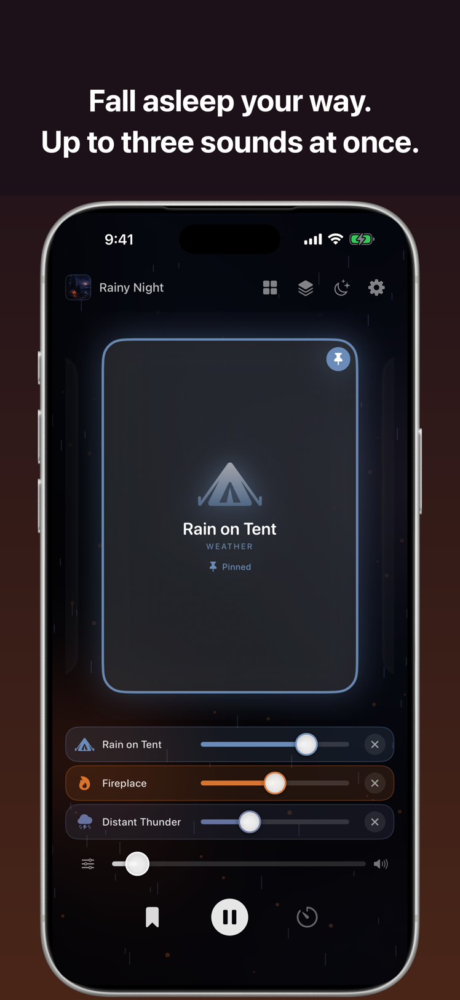

🇺🇸 [English](README.md) | 🇩🇪 [Deutsch](README_de.md) | 🇪🇸 [Español](README_es.md) | 🇫🇷 [Français](README_fr.md) | 🇮🇹 [Italiano](README_it.md) | 🇯🇵 [日本語](README_ja.md) | 🇳🇱 [Nederlands](README_nl.md) | 🇧🇷 [Português](README_pt-BR.md) | 🇨🇳 **中文**

# Dreamwave Radio - 适用于 iPhone 和 iPad 的助眠声音、白噪声与环境混音器

**把环境声音混成你自己的一份，在定时器里入睡。没有账户，没有追踪，什么都不离开你的设备。**

**一次购买，永久拥有。** 没有订阅，没有广告，没有应用内购买。

大多数助眠应用给你一份固定的播放列表和一张每月的账单。Dreamwave Radio 给你一台调音台。把雨声叠在壁炉上，把风扇垫在夜行列车下面，分别调节每一层的音量，直到它听起来像你真正想在里面入睡的那个房间。

---

## 🆕 2.0 新功能

- **全新外观：** 每个混音现在都有自己的封面。正在播放的混音显示在屏幕顶部，你的混音以封面网格展开，封面在你的声音背后柔和地发光。
- **梦境：** 三种适合夜晚和专注的新声音：霓虹地平线、午夜低鸣和电子管嗡鸣。另有两个新的现成混音：霓虹海岸和午夜雨。
- **用中文和 Siri 说话：** Siri 现在能听懂中文了。比如说“在Dreamwave里播放雨打帐篷”或“在Dreamwave里再给我点时间”。
- **全新图标，** 主屏幕上的应用名称现在简化为 Dreamwave。
- **你的混音依然是你的：** 你保存的混音保持不变，还可以用自己的照片作为每个混音的封面。新混音会在还有空位时加入。

---

## ✨ 与众不同之处

### 🎚️ 最多同时混合三种声音

这不是播放列表，而是一份混音。固定最多三个声音，各自调节音量。远雷之上是打在帐篷上的雨。壁炉之下是夜风。组合本身才是重点。

### 💾 一键混音

从五个现成的混音开始：雨夜、专注、轻柔入睡、霓虹海岸和午夜雨。也可以保存你自己的混音：固定最多三个声音，调好每层音量，再点播放旁边的书签。每个混音都有自己的封面，你保存的混音还可以用自己的照片作封面。你的混音以封面网格展开，轻点一下即可找回任何一个，连同音量。

### 📚 专注与学习

同样的声音在白天也有用。在窗上的雨声下铺一层棕噪声，可以盖住办公室、咖啡馆或家里的说话声，让你专注、学习或阅读。

### 🔊 整夜安静

没有咔哒声，没有听得出的衔接。只要你需要，声音就会一直平稳地播放，漫长的夜晚始终是一段安静、连贯的声音，而不是一遍遍从头开始的音轨。夜风随阵阵风势起伏。远处的雨里，每一滴都落在新的地方。猫咪呼噜会像真猫一样停顿片刻。

### 🗣️ 开口就行

“在Dreamwave里播放雨声”“在Dreamwave里再给我点时间”Siri 和快捷指令可以播放你的声音，你不必去看明亮的屏幕。Siri 现在能听懂中文了。Siri 能做的一切也都是快捷指令，声音因此可以成为你睡前流程的一部分。

### ⏱️ 会淡出的定时器

既有常用夜晚的预设，也可以把刻度拖到 1 到 120 分钟之间的任意时长。混音是渐渐淡出而不是戛然而止，所以定时器离开时从不会把你吵醒。运行期间，它会显示在锁定屏幕和灵动岛上，一眼就能看到还剩多久。

### 🌙 夜间模式

把整个界面调暗，适合漆黑的卧室，所以查看定时器不必拿手电筒照自己的脸。

### 📱 在 iPhone 和 iPad 上都自在

一个应用，为两者打造。在 iPhone 上，黑暗中也能单手够到。在 iPad 上，声音库全屏打开，整个库一次呈现在你面前。

### 🎧 与播客一起播放

在设置中打开「与其他音频同时播放」，你的混音就会在播客或有声书下面轻轻播放，而不会让它停下。默认关闭。

### 🔒 没有账户、没有网络、没有数据

没有注册，没有分析，没有服务器，应用也从不请求麦克风权限。你选作混音封面的照片会留在你的设备上。应用不收集数据，因为它无处可发。请参阅[隐私政策](privacy_policy.md)。

---

## 📸 截图

| | | |
|:--:|:--:|:--:|
|  |  |  |
|  |  |  |

---

## 🎵 声音库

六个类别共 34 种声音，从纯粹的噪声到夜色中驶过的列车。

**噪声** - 白噪声 · 粉红噪声 · 深邃静谧（棕噪声） · 灰噪声 · 绿噪声 · 蓝噪声 · 紫噪声
**舒缓** - 母体 · 风扇声 · 车行途中 · 缓缓漂流 · 猫咪呼噜 · 客舱 · 嘘声
**天气** - 雨打帐篷 · 雨打窗棂 · 远处雷声 · 夜风 · 远处的雨 · 草原之风
**自然** - 深海 · 林间夜色 · 夏日街巷 · 山间溪流 · 鸟鸣 · 蟋蟀
**惬意** - 壁炉 · 夜行列车 · 黑胶噼啪 · 淋浴 · 摇曳小船
**梦境** - 霓虹地平线 · 午夜低鸣 · 电子管嗡鸣

---

## ❓ 常见问题

**为什么主屏幕上的应用叫 Dreamwave？**

从 2.0 起，图标下方的名称简化为 Dreamwave。应用本身仍然叫 Dreamwave Radio，在 App Store 和应用内都是如此，Siri 两个名字都能听懂。

**更新后，我保存的混音还在吗？**

在。你保存的混音完全保持原样。两个新的现成混音霓虹海岸和午夜雨会在还有空位时加入，你还可以用自己的照片作为每个混音的封面。

**如果我已经买了这个应用，2.0 要另外付费吗？**

不用。2.0 是给所有已拥有 Dreamwave Radio 的用户的免费更新。一次购买，永久拥有：所有声音以及未来新增的声音全部包含。

**应用需要访问我的照片吗？**

不需要。当你为混音选择封面照片时，系统照片选择器只会把你选中的那一张交给应用，绝不会开放你的照片图库。照片留在你的设备上，从不上传。

**可以离线使用吗？**

可以，完全离线。每个声音都直接在你的设备上播放，开飞行模式、坐火车或住在没有 Wi-Fi 的酒店都能用。

**对耳鸣有帮助吗？**

很多人会用柔和的噪声让耳鸣不那么明显。Dreamwave Radio 有七种噪声颜色，你可以找到适合自己的那一种。它不是医疗器械，也不能治疗耳鸣。如果你经常耳鸣，或者耳鸣是最近才出现的，请去看医生。

---

## 📱 系统要求

- iOS 17.0 或更高版本
- iPhone 和 iPad

---

## 🌍 语言

英语、德语、西班牙语、法语、意大利语、日语、荷兰语、巴西葡萄牙语和简体中文。声音名称也已翻译。

---

## 💬 反馈

这个仓库是提供支持的地方。它不含源代码：用于问题反馈、文档和隐私政策。

- [报告缺陷](https://github.com/aloth/dreamwave-radio/issues/new?template=bug-report.md) - 崩溃、无法播放的声音、任何与文档不符的情况
- [建议功能](https://github.com/aloth/dreamwave-radio/issues/new?template=feature_request.md) - 你想要的声音、你缺少的设置
- [浏览现有问题](https://github.com/aloth/dreamwave-radio/issues) - 也许有人已经报告过
- [support@alexloth.com](mailto:support@alexloth.com?subject=Dreamwave%20Radio) - 任何你不愿公开的内容

---

## 📄 法律

- [隐私政策](privacy_policy.md)
- [使用条款（Apple 标准 EULA）](https://www.apple.com/legal/internet-services/itunes/dev/stdeula/)

---

由 [Alexander Loth](https://github.com/aloth) 打造 · [alexloth.com](https://alexloth.com) · [X](https://x.com/xlth)

*为更安静的夜晚。* © 2026 Alexander Loth
